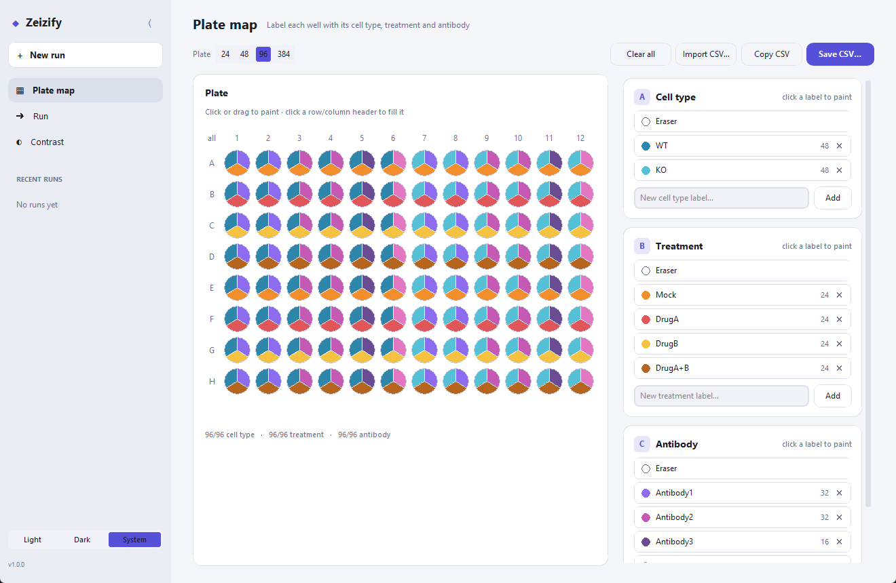
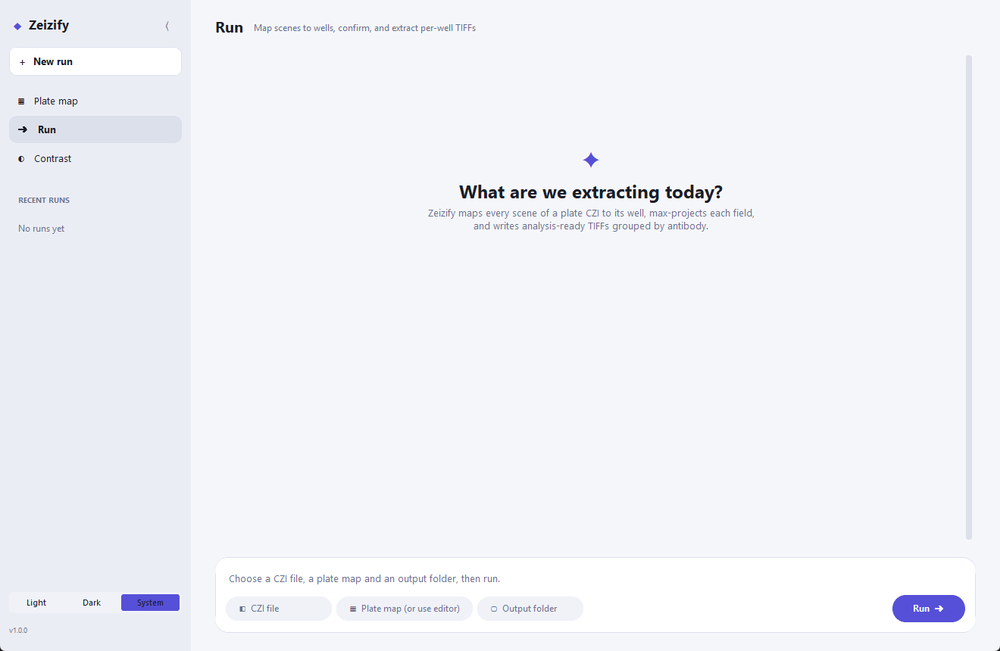
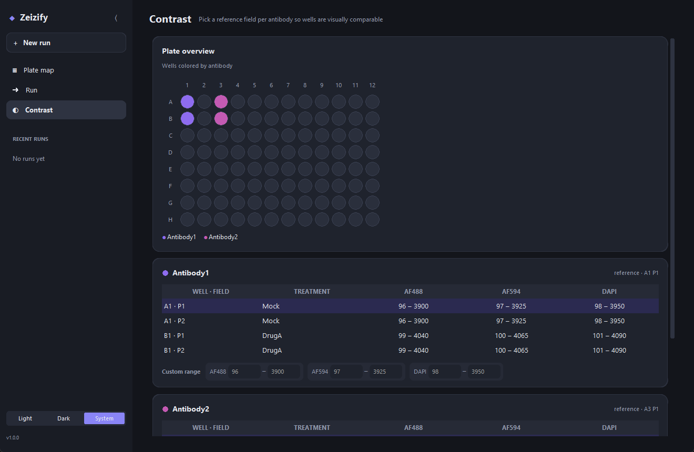
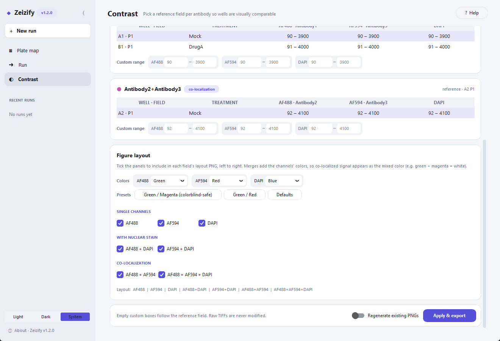

# Zeizify

**Per-well extraction of Zeiss CZI multi-well plate acquisitions.**

Zeizify takes a multi-well-plate `.czi` acquired in ZEN (scenes = wells × fields) and a plate map describing
what is in each well (including several antibodies per well for co-localization), and produces
analysis-ready, per-well, per-field, per-channel TIFFs grouped by staining panel, together with
control-referenced contrast ranges, configurable figure-style layout PNGs and a provenance manifest.

| Plate map editor (two-antibody co-localization) | Run timeline |
|---|---|
|  |  |

| Contrast (dark mode) | Figure layout and co-localization merges |
|---|---|
|  |  |

---

## Features

- **Scene → well mapping you can trust.** Well IDs are read directly from the CZI's own metadata
  (`Scene/ArrayName`, or the scene's `Shape` name, both written by ZEN) and cross-checked against
  `Shape/RowIndex|ColumnIndex`. Files without well IDs fall back to stage positions, which works for full and
  partially imaged plates (e.g. only columns 2–5). That result must be confirmed by a human on a QC plot (first
  imaged well, flip rows / columns) before any well is processed.
- **Memory-safe extraction.** Only one scene's subblocks are read at a time. Multi-hundred-GB files are never
  loaded whole. Reads are retried on transient (network-drive) errors.
- **Per-channel Z max projection**, written once per channel as a TIFF with the physical pixel size embedded
  (ImageJ-compatible, µm).
- **Resumable.** Fields whose files already exist are not re-decoded, so an interrupted run picks up where it stopped.
- **Plate map editor.** Paint 24/48/96/384-well plates with cell type, treatment and the antibody in each
  fluorophore channel, then export, import or copy the CSV.
- **Co-localization ready.** Declare as many fluorophore channels as you stained (AF488, AF594, AF647…), and
  each well can carry a different antibody in each channel. Wells are grouped by staining panel (e.g.
  `CD7+HLA`), every output image is tagged with its antibody, and layouts include co-localization merges.
- **Control-referenced contrast.** Per antibody panel, choose a reference field (e.g. the mock-treated well)
  whose min/max becomes the display range for all other wells of that panel, or type a custom range for any
  channel. Ranges are written to a sidecar CSV, and the raw TIFFs are never modified.
- **Saturation flagging** against the sensor bit depth read from metadata.
- **Configurable layout PNGs.** Choose any combination of single channels, nuclear-stain merges and
  co-localization merges, and each channel's pseudocolor (green/magenta preset for colorblind-safe figures).
  Panels are captioned with antibody names.
- **Reproducibility.** Every run writes `run_manifest.json` (inputs, parameters, mapping source, software
  versions, contrast choices).
- **GUI and CLI.** A modern desktop app (light/dark) for interactive work, and a scriptable CLI for batch runs.
- **Zeizify Analyze.** Per-nucleus quantification of nuclear speckles / bodies and colocalization on the
  extracted images: Cellpose or classical nuclei, per-nucleus spot detection, counts, sizes, dispersal,
  Pearson / Manders–Costes / ICQ and object overlap, replicate-level statistics and SuperPlots. Runs in
  parallel. See [Zeizify Analyze](#zeizify-analyze).

## Installation

Requires **Python ≥ 3.12**. The zstd-compressed subblocks written by recent ZEN versions need
`czifile`/`imagecodecs` builds that only ship for 3.12+.

```bash
git clone https://github.com/AtreyaPaturi/Zeizify.git
cd Zeizify

# create and activate the environment
python -m venv Zeizify_env
Zeizify_env\Scripts\activate          # Windows
# source Zeizify_env/bin/activate     # macOS / Linux

pip install -e .                      # or, for the exact tested versions: pip install -r requirements.txt && pip install -e .
```

On Linux, tkinter may need to be installed separately (e.g. `sudo apt install python3-tk`).

**Optional: Cellpose for nuclear segmentation (recommended for Zeizify Analyze).** Without it, a classical
segmentation is used.

```bash
pip install cellpose
# GPU (NVIDIA): installing cellpose pulls a CPU-only PyTorch from PyPI. Replace it with the CUDA build
# matching your driver, e.g. CUDA 12.8 (RTX 50-series needs cu128 or newer):
pip install --force-reinstall --no-deps torch torchvision --index-url https://download.pytorch.org/whl/cu128
python -c "import torch; print(torch.cuda.is_available())"   # should print True
```

The Analyze page and log report whether Cellpose is running on the GPU. The GPU is roughly 10× faster than the
CPU. The first Cellpose run downloads its model (~1.2 GB).

## Quick start (GUI)

```bash
zeizify            # or: zeizify-gui, or: python -m zeizify
```

1. **Plate map.** Pick the plate format and list your stained channels under *Fluorophores* (e.g. AF488 and
   AF594). Each fluorophore gets an *Antibody* card. Type labels under *Cell type*, *Treatment* and each
   antibody card, select a label and click or drag across wells to paint them. For co-localization, paint a
   different antibody in each channel of the same wells. Click a row letter, column number or `all` to fill a
   whole line. Each well shows one wedge per category. *Save CSV…* writes the plate map, and *Import CSV…*
   loads an existing one. The editor autosaves to `~/.zeizify/plate_state.json`.
2. **Run.** In the composer at the bottom, choose the `.czi` file, a plate map CSV (or leave it empty to use the
   editor's current map) and an output folder, then press **Run**.
3. **Confirm the mapping.** A QC plot of every field's stage position, labeled by well, appears in the timeline.
   If the well IDs came from metadata, check it and continue. If they were inferred from geometry, check the
   *First imaged well* (e.g. A2 if you started in column 2) and use *Flip rows* / *Flip columns* until the
   labels match the plate, then continue. Nothing is extracted until you confirm.
4. **Extraction** runs in the background with a progress bar and live log. *Stop* finishes the current field
   and stops. Running again resumes.
5. **Contrast.** For each antibody panel, select the reference field (a control-like treatment such as
   Mock/DMSO/vehicle is pre-selected) and optionally type custom ranges. Under *Figure layout*, tick the panels
   to include (single channels, `+DAPI` merges, co-localization merges such as `AF488 + AF594`) and choose
   each channel's color. Then press **Apply & export**.

Recent runs appear in the sidebar. Click one to reload its inputs.

**Help and version.** Every page has a **Help** button (or press **F1**) that opens a side panel explaining
how to use that page. The version you are running is shown in the window title and next to the logo. Click
it (or *About* in the sidebar) to see the exact Zeizify, Python and library versions, and use
*Copy version info* when reporting a problem or writing your methods.

## Command line

```bash
# metadata summary (channels, scenes, pixel size, bit depth)
zeizify info plate.czi

# scene -> well mapping + QC outputs only
zeizify map plate.czi -o out/

# full, non-interactive extraction
zeizify extract plate.czi -p plate_map.csv -o out/ --yes \
    --control CD7+HLA=A1:P1 \
    --range CD7+HLA:AF594=150:4000 \
    --panel AF488 --panel AF594 --panel AF488+AF594 --panel AF488+AF594+DAPI \
    --color AF488=green --color AF594=magenta
```

| Option | Meaning |
|---|---|
| `--plate {6,12,24,48,96,384}` | plate format (default 96) |
| `--flip-rows`, `--flip-cols` | orientation for the geometry fallback (A1 at bottom / right) |
| `--first-well WELL` | geometry fallback: the imaged well closest to A1, e.g. `A2` (default `A1`) |
| `--yes` | accept the mapping without the interactive prompt (inspect `_scene_mapping/scene_to_well_qc.png`!) |
| `--control AB=WELL:FIELD` | reference field per antibody (default: first control-like treatment) |
| `--range AB:CHANNEL=MIN:MAX` | custom display range for one antibody/channel |
| `--panel CH[+CH...]` | a layout panel, e.g. `AF488+AF594` (repeatable; replaces the default panels) |
| `--color CH=COLOR` | pseudocolor: red, green, blue, magenta, cyan, yellow or gray |
| `--overwrite-png` | regenerate existing layout PNGs |

## Plate map format

One row per well, with one `Antibody_<fluorophore>` column per stained channel. Wells with an empty `Label` are
skipped. See [`examples/plate_map_colocalization.csv`](examples/plate_map_colocalization.csv).

```csv
Well,Row,Column,CellType,Treatment,Antibody_AF488,Antibody_AF594,Antibody,Label
A1,A,1,WT,Mock,CD7,HLA,CD7+HLA,WT_Mock_CD7_HLA
A2,A,2,WT,DrugA,CD7,,CD7,WT_DrugA_CD7
```

- `Antibody` is the well's staining panel: its per-channel antibodies joined with `+`. Wells with the same
  panel share an output folder and a reference contrast.
- `Label` is the slugged join of cell type, treatment and panel, and becomes the file-name prefix.
- Fluorophore names should match the CZI channel names (e.g. `AF488`) so each image is tagged with its
  antibody. A match on wavelength (`Alexa 488` ↔ `AF488`) also works.
- Hand-made CSVs are accepted: `Antibody` and `Label` are filled in when missing, well IDs are normalized
  (`A01` → `A1`) and labels are re-slugged.
- Single-antibody files with only an `Antibody` column (Zeizify ≤ 1.1, see
  [`examples/plate_map_example.csv`](examples/plate_map_example.csv)) still work.

## Outputs

```
out/
├── _scene_mapping/
│   ├── scene_to_well.csv          Scene, Field, Well, StageY, StageX, Source
│   └── scene_to_well_qc.png       stage-position QC plot
├── <Panel>/                       e.g. CD7_HLA/ (one folder per staining panel)
│   ├── <Label>_<Well>_<Field>_<Channel>.tif    Z max projection, µm scale embedded
│   └── png/<Label>_<Well>_<Field>_layout.png   default: AF488 | AF594 | DAPI | AF488+DAPI | AF594+DAPI
│                                               | AF488+AF594 | AF488+AF594+DAPI
├── intensity_report.csv           per field/channel: antibody (Stain), own min/max, saturation, reference range
├── plate_map.csv                  (when the editor's map was used)
└── run_manifest.json              inputs, parameters, software versions, contrast choices
```

`intensity_report.csv` is meant to be applied at view or analysis time (e.g. a Fiji macro or your own
quantification). Zeizify never rescales or rewrites the extracted TIFFs.

## Zeizify Analyze

Quantify nuclear speckles / bodies and protein colocalization, nucleus by nucleus, on an extraction. Open the
**Analyze** page, or press *Analyze* after an export, or use the CLI:

```bash
zeizify analyze out/                                  # defaults: Cellpose if installed, all channels
zeizify analyze out/ --spot-diameter 0.3 2 --sensitivity 5 --randomizations 100 --replicate-column Replicate
```

1. **Nuclei** are segmented from DAPI with Cellpose (or classical threshold + watershed). Edge-touching
   nuclei are removed, and condensed (mitotic / apoptotic), dim or saturated nuclei are flagged and left out of
   statistics.
2. **Spots** are detected inside each nucleus per channel: top-hat background removal, a per-nucleus threshold
   with a noise floor, and a size window in µm.
3. **Per nucleus**: spot count, size, shape and intensity, background-paired intensities, and threshold-free
   dispersal (intensity CV, spot/nucleoplasm enrichment, fraction of signal in spots).
4. **Colocalization** for every channel pair: Pearson, Spearman, Li ICQ, Manders tM1/tM2 with Costes
   thresholds (Fiji Coloc 2 definitions), optional Costes significance, and object overlap / enrichment over
   chance / nearest-neighbour distance. Single-stain wells are labelled as bleed-through controls.
5. **Statistics** on replicate medians (SuperPlots): Welch ANOVA, Games-Howell, BH q-values, Hedges' g and
   Cliff's delta, plus SuperPlot figures.

Use **Preview** on the Analyze page to check segmentation on one field before the full run. Nuclear masks are
cached, so re-tuning spot settings re-runs quickly. Results go to `out/analysis/`.

**Replicates.** By default a replicate is a well. For p-values each treatment needs ≥ 2 replicates; add a
`Replicate` column to the plate map for biological replicates. With one well per condition, effect sizes
are reported but no tests.

Full methods, the source each step follows, and validation are in [`docs/analysis.md`](docs/analysis.md).

## How it works

See [`docs/methods.md`](docs/methods.md) for a methods-section-ready description,
[`docs/analysis.md`](docs/analysis.md) for the analysis methods, and [`docs/validation.md`](docs/validation.md)
for how the implementation was cross-validated against existing tools.

## Limitations

- Each scene is expected to be a single field (one tile) at one time point. Scenes with several mosaic tiles or
  time points are refused rather than silently merged into one projection.
- Max-intensity projection discards Z by design.
- Default layout colors are assigned by fluorophore name (DAPI/Hoechst → blue, 488/GFP → green,
  546–594/Cy3/RFP → red, 640–670/Cy5 → magenta, otherwise gray) and can be changed per run.
- Layout merges are for visualization only. Colocalization coefficients are computed by Zeizify Analyze.
- Zeizify Analyze works on 2-D maximum projections. Projection can create apparent overlap between objects at
  different depths, so object-based colocalization is an upper bound compared with 3-D analysis.

## Project layout

```
src/zeizify/
├── czi_metadata.py   XML metadata parsing (scenes, channels, scaling, bit depth)
├── mapping.py        scene -> well mapping (metadata + geometric fallback)
├── qc.py             QC CSV and plots
├── extraction.py     per-field, per-channel Z max projection and TIFF writing
├── contrast.py       reference ranges and intensity report
├── layout.py         figure-style layout PNGs
├── pipeline.py       high-level steps + run manifest (shared by GUI and CLI)
├── plate.py          plate formats and plate map CSV
├── cli.py            command-line interface
├── analysis/         Zeizify Analyze: segment, measure, coloc, stats, run (parallel)
└── gui/              desktop app (customtkinter); help text lives in gui/help.py
tests/                pytest suite with synthetic CZI fixtures
docs/                 methods, validation, screenshots
examples/             example plate map
```

## Development

```bash
pip install -e ".[dev]"
pytest
```

The tests use synthetic metadata and in-memory subblocks, so no CZI files are needed. They cover metadata
parsing, metadata- and geometry-based mapping (including tilt, jitter, flips, uneven field counts and 384-well
plates), projection, resume, saturation, contrast, layouts and an end-to-end CLI run.

## Versioning and releases

Zeizify follows [Semantic Versioning](https://semver.org/). The version is defined once, in
`zeizify.__version__` (`src/zeizify/__init__.py`), and appears in the GUI, `zeizify --version` and every `run_manifest.json`.
Changes are listed in [CHANGELOG.md](CHANGELOG.md). To release a new version:

1. Bump `__version__` in `src/zeizify/__init__.py` and `version:` in `CITATION.cff`.
2. Add a `## [x.y.z]` section to `CHANGELOG.md`.
3. Run `pytest` (it fails if these three disagree), commit, then tag: `git tag vx.y.z && git push --tags`.

## Citation

If Zeizify contributes to published work, please cite it using the metadata in [`CITATION.cff`](CITATION.cff)
(GitHub's "Cite this repository" button).

## Related tools

- [czifile](https://github.com/cgohlke/czifile) by Christoph Gohlke, the CZI reader Zeizify is built on.
- [czitools](https://github.com/sebi06/czitools) by ZEISS, general CZI metadata and pixel access, including well-plate (Plate → Well → Field) interpretation.
- [pylibCZIrw](https://pypi.org/project/pylibCZIrw/) by ZEISS, the official libCZI Python bindings.
- [wellmap](https://wellmap.readthedocs.io/), a TOML file format for plate layouts.

## License

MIT. See [LICENSE](LICENSE).
