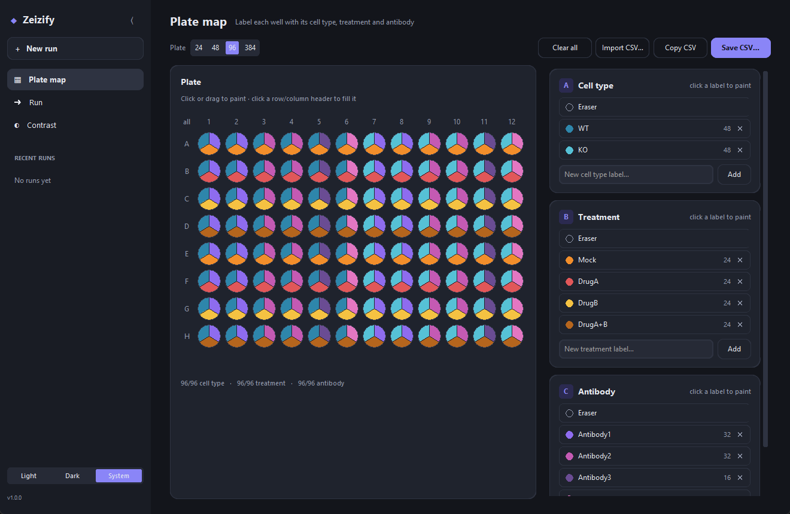

# Zeizify

**Per-well extraction of Zeiss CZI multi-well plate acquisitions.**

Zeizify takes a multi-well-plate `.czi` acquired in ZEN (scenes = wells × fields) and a plate map describing
what is in each well, and produces analysis-ready, per-well, per-field, per-channel TIFFs grouped by antibody,
together with control-referenced contrast ranges, figure-style layout PNGs and a provenance manifest.

| Plate map editor | Run timeline |
|---|---|
|  |  |

| Contrast (dark mode) | Plate map (dark mode) |
|---|---|
|  |  |

---

## Features

- **Scene → well mapping you can trust.** Well IDs are read directly from the CZI's own metadata
  (`Scene/ArrayName`, written by ZEN) and cross-checked against `Shape/RowIndex|ColumnIndex`. Older or
  third-party files without well IDs fall back to clustering stage positions, and the result must be
  confirmed by a human on a QC plot (with flip-rows / flip-columns controls) before any well is processed.
- **Memory-safe extraction.** Only one scene's subblocks are read at a time. Multi-hundred-GB files are never
  loaded whole. Reads are retried on transient (network-drive) errors.
- **Per-channel Z max projection**, written once per channel as a TIFF with the physical pixel size embedded
  (ImageJ-compatible, µm).
- **Resumable.** Fields whose files already exist are not re-decoded, so an interrupted run picks up where it stopped.
- **Plate map editor.** Paint 24/48/96/384-well plates with three independent categories (cell type, treatment,
  antibody), then export, import or copy the CSV.
- **Control-referenced contrast.** Per antibody, choose a reference field (e.g. the mock-treated well) whose
  min/max becomes the display range for all other wells of that antibody, or type a custom range for any
  channel. Ranges are written to a sidecar CSV, and the raw TIFFs are never modified.
- **Saturation flagging** against the sensor bit depth read from metadata.
- **Layout PNGs**: solo channels plus DAPI merges side by side, pseudocolored by fluorophore.
- **Reproducibility.** Every run writes `run_manifest.json` (inputs, parameters, mapping source, software
  versions, contrast choices).
- **GUI and CLI.** A modern desktop app (light/dark) for interactive work, and a scriptable CLI for batch runs.

## Installation

Requires **Python ≥ 3.12**. The zstd-compressed subblocks written by recent ZEN versions need
`czifile`/`imagecodecs` builds that only ship for 3.12+.

```bash
git clone https://github.com/AtreyaPaturi/Zeizify.git
cd Zeizify

# create and activate the environment
python -m venv Zeizify_env
Zeizify_env\Scripts\activate          # Windows
# source Zeizify_env/bin/activate     # macOS / Linux

pip install -e .                      # or, for the exact tested versions: pip install -r requirements.txt && pip install -e .
```

On Linux, tkinter may need to be installed separately (e.g. `sudo apt install python3-tk`).

## Quick start (GUI)

```bash
zeizify            # or: zeizify-gui, or: python -m zeizify
```

1. **Plate map.** Pick the plate format, type labels under *Cell type*, *Treatment* and *Antibody*, select a
   label and click or drag across wells to paint them. Click a row letter, column number or `all` to fill a
   whole line. Each well shows its three categories as three wedges. *Save CSV…* writes the plate map, and
   *Import CSV…* loads an existing one. The editor autosaves to `~/.zeizify/plate_state.json`.
2. **Run.** In the composer at the bottom, choose the `.czi` file, a plate map CSV (or leave it empty to use the
   editor's current map) and an output folder, then press **Run**.
3. **Confirm the mapping.** A QC plot of every field's stage position, labeled by well, appears in the timeline.
   If the well IDs came from metadata, check it and continue. If they were inferred from geometry, use
   *Flip rows* / *Flip columns* until A1 is where it physically was, then continue. Nothing is extracted until
   you confirm.
4. **Extraction** runs in the background with a progress bar and live log. *Stop* finishes the current field
   and stops. Running again resumes.
5. **Contrast.** For each antibody, select the reference field (a control-like treatment such as
   Mock/DMSO/vehicle is pre-selected), optionally type custom ranges, then **Apply & export**.

Recent runs appear in the sidebar. Click one to reload its inputs.

**Help and version.** Every page has a **Help** button (or press **F1**) that opens a side panel explaining
how to use that page. The version you are running is shown in the window title and next to the logo. Click
it (or *About* in the sidebar) to see the exact Zeizify, Python and library versions, and use
*Copy version info* when reporting a problem or writing your methods.

## Command line

```bash
# metadata summary (channels, scenes, pixel size, bit depth)
zeizify info plate.czi

# scene -> well mapping + QC outputs only
zeizify map plate.czi -o out/

# full, non-interactive extraction
zeizify extract plate.czi -p plate_map.csv -o out/ --yes \
    --control CD7=A1:P1 \
    --range CD7:AF594=150:4000
```

| Option | Meaning |
|---|---|
| `--plate {6,12,24,48,96,384}` | plate format (default 96) |
| `--flip-rows`, `--flip-cols` | orientation for the geometry fallback (A1 at bottom / right) |
| `--yes` | accept the mapping without the interactive prompt (inspect `_scene_mapping/scene_to_well_qc.png`!) |
| `--control AB=WELL:FIELD` | reference field per antibody (default: first control-like treatment) |
| `--range AB:CHANNEL=MIN:MAX` | custom display range for one antibody/channel |
| `--overwrite-png` | regenerate existing layout PNGs |

## Plate map format

One row per well. Wells with an empty `Label` are skipped. See [`examples/plate_map_example.csv`](examples/plate_map_example.csv).

```csv
Well,Row,Column,CellType,Treatment,Antibody,Label
A1,A,1,WT,Mock,Antibody1,WT_Mock_Antibody1
A2,A,2,WT,Mock,Antibody1,WT_Mock_Antibody1
```

`Label` is the slugged join of the three categories and becomes the file-name prefix. Hand-edited CSVs are
accepted: well IDs are normalized (`A01` → `A1`) and labels are re-slugged.

## Outputs

```
out/
├── _scene_mapping/
│   ├── scene_to_well.csv          Scene, Field, Well, StageY, StageX, Source
│   └── scene_to_well_qc.png       stage-position QC plot
├── <Antibody>/
│   ├── <Label>_<Well>_<Field>_<Channel>.tif    Z max projection, µm scale embedded
│   └── png/<Label>_<Well>_<Field>_layout.png   e.g. AF488 | AF594 | DAPI | AF488+DAPI | AF594+DAPI
├── intensity_report.csv           per field/channel: own min/max, saturation, reference range
├── plate_map.csv                  (when the editor's map was used)
└── run_manifest.json              inputs, parameters, software versions, contrast choices
```

`intensity_report.csv` is meant to be applied at view or analysis time (e.g. a Fiji macro or your own
quantification). Zeizify never rescales or rewrites the extracted TIFFs.

## How it works

See [`docs/methods.md`](docs/methods.md) for a methods-section-ready description, and
[`docs/validation.md`](docs/validation.md) for how the implementation was cross-validated against existing
CZI tooling.

## Limitations

- Each scene is expected to be a single field (one tile) at one time point. Scenes with several mosaic tiles or
  time points are refused rather than silently merged into one projection.
- Max-intensity projection discards Z by design.
- Layout PNG colors are assigned by fluorophore name (DAPI/Hoechst → blue, 488/GFP → green,
  555–594/Cy3/RFP → red, 640–670/Cy5 → magenta, otherwise gray). See `zeizify/layout.py`.

## Project layout

```
src/zeizify/
├── czi_metadata.py   XML metadata parsing (scenes, channels, scaling, bit depth)
├── mapping.py        scene -> well mapping (metadata + geometric fallback)
├── qc.py             QC CSV and plots
├── extraction.py     per-field, per-channel Z max projection and TIFF writing
├── contrast.py       reference ranges and intensity report
├── layout.py         figure-style layout PNGs
├── pipeline.py       high-level steps + run manifest (shared by GUI and CLI)
├── plate.py          plate formats and plate map CSV
├── cli.py            command-line interface
└── gui/              desktop app (customtkinter); help text lives in gui/help.py
tests/                pytest suite with synthetic CZI fixtures
docs/                 methods, validation, screenshots
examples/             example plate map
```

## Development

```bash
pip install -e ".[dev]"
pytest
```

The tests use synthetic metadata and in-memory subblocks, so no CZI files are needed. They cover metadata
parsing, metadata- and geometry-based mapping (including tilt, jitter, flips, uneven field counts and 384-well
plates), projection, resume, saturation, contrast, layouts and an end-to-end CLI run.

## Versioning and releases

Zeizify follows [Semantic Versioning](https://semver.org/). The version is defined once, in
`zeizify.__version__` (`src/zeizify/__init__.py`), and appears in the GUI, `zeizify --version` and every `run_manifest.json`.
Changes are listed in [CHANGELOG.md](CHANGELOG.md). To release a new version:

1. Bump `__version__` in `src/zeizify/__init__.py` and `version:` in `CITATION.cff`.
2. Add a `## [x.y.z]` section to `CHANGELOG.md`.
3. Run `pytest` (it fails if these three disagree), commit, then tag: `git tag vx.y.z && git push --tags`.

## Citation

If Zeizify contributes to published work, please cite it using the metadata in [`CITATION.cff`](CITATION.cff)
(GitHub's "Cite this repository" button).

## Related tools

- [czifile](https://github.com/cgohlke/czifile) by Christoph Gohlke, the CZI reader Zeizify is built on.
- [czitools](https://github.com/sebi06/czitools) by ZEISS, general CZI metadata and pixel access, including well-plate (Plate → Well → Field) interpretation.
- [pylibCZIrw](https://pypi.org/project/pylibCZIrw/) by ZEISS, the official libCZI Python bindings.
- [wellmap](https://wellmap.readthedocs.io/), a TOML file format for plate layouts.

## License

MIT. See [LICENSE](LICENSE).
